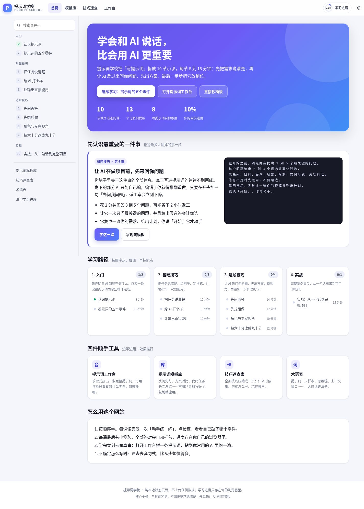
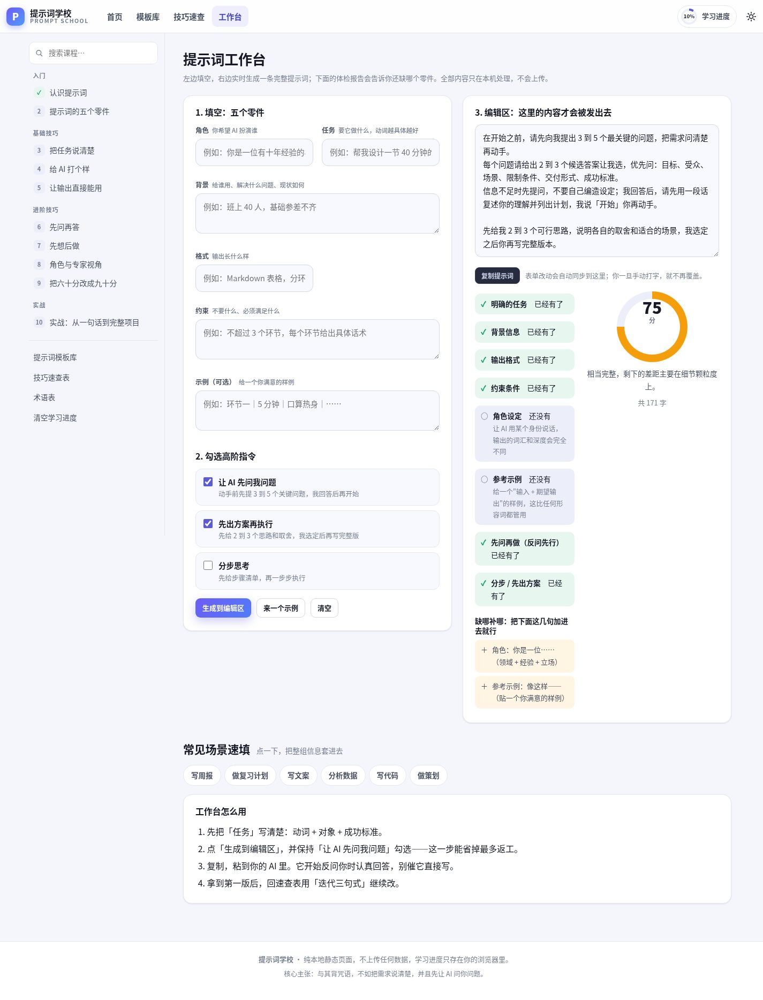
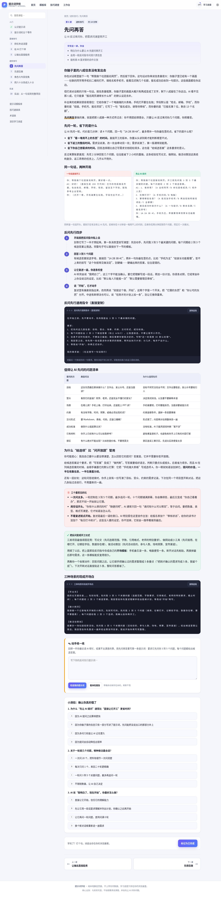

# 提示词学校 Prompt School

一个纯静态的网页，把"怎么写 AI 提示词"拆成 10 节可以一步步学完的小课，并配了模板库、技巧速查表、术语表和两个能立刻上手的小工具：**提示词工作台**和**提示词体检器**。

核心主张只有一句：**与其背咒语，不如把需求说清楚；而且要让 AI 在动手之前先来问你问题。**

## 怎么打开

不需要安装任何东西，不需要联网，不需要构建：

- 直接双击 `index.html`，用浏览器打开即可；
- 或者在目录里起一个静态服务（可选）：
  ```
  python3 -m http.server 8000
  ```
  然后访问 http://localhost:8000

学习进度、练习草稿、主题偏好都保存在你自己浏览器的 localStorage 里，页面上的一切内容都在本机处理，不会上传。

## 界面预览







## 学什么

| 模块 | 课程 | 技能点 |
| --- | --- | --- |
| 入门 | 1 认识提示词 / 2 提示词的五个零件 | AI 在猜你的心思；角色、任务、背景、格式、约束 |
| 基础技巧 | 3 把任务说清楚 / 4 给 AI 打个样 / 5 让输出直接能用 | 动词与成功标准；少样本提示；输出格式 |
| 进阶技巧 | 6 **先问再答** / 7 先想后做 / 8 角色与专家视角 / 9 把六十分改成九十分 | 让 AI 先提问再开工；先出方案；角色扮演；迭代改稿 |
| 实战 | 10 从一句话到完整项目 | 完整对话复盘，把前面的技巧串起来 |

第 6 课是全校最重要的一课：**让 AI 在开始做项目之前，先向你提问。** 你写进提示词的信息通常不到你脑子里信息的两成，剩下的部分 AI 只能自己编；加一句"先问我 3 到 5 个关键问题"，返工率会立刻下降。首页、模板库和速查表里都把这条放在最显眼的位置。

## 页面功能

- **课程页**：学习目标 → 讲解 → 差/好提示词对比 → 可复制模板 → 避坑提示 → 动手练习（写完点检查，按关键词给出达标项）→ 小测验（全部答对自动打勾）→ 上一课/下一课。
- **提示词工作台**（#/playground）：填空式拼出五个零件，勾选"让 AI 先问我问题""先出方案再执行""分步思考"，实时生成一条完整提示词，一键复制；右侧体检器实时打分。
- **提示词体检器**：本地规则检查 8 个维度（任务、背景、格式、约束、角色、示例、先问再做、分步/先出方案），给出分数、缺哪补哪的补丁句，以及字数提示。
- **模板库**（#/templates）：13 个可直接复制的场景模板，支持按标签筛选。
- **技巧速查表**（#/cheatsheet）：8 组技巧卡，每张都带可套用的句式。
- **术语表**（#/glossary）：15 条大白话解释。
- 侧边栏课程搜索（快捷键 `/`）、深色模式、移动端抽屉目录、打印样式。

## 目录结构

```
index.html                  页面骨架（顶栏、侧边栏、内容容器）
assets/css/style.css        设计系统与全部样式（含深色模式、响应式）
assets/js/data-lessons-a.js 第 1-5 课内容数据
assets/js/data-lessons-b.js 第 6-10 课内容数据
assets/js/data-extra.js     模板库 / 技巧速查表 / 术语表数据
assets/js/checker.js        提示词体检器的检查规则
assets/js/app.js            路由、渲染、测验、进度、工作台交互
tools/verify.mjs            端到端自检脚本（真实浏览器里跑一遍）
screenshots/                各页面截图（node tools/verify.mjs --shots 生成）
SCHEMA.md                   课程数据的字段契约
```

## 自己加一课

课程内容是数据，不是页面。照着 `SCHEMA.md` 的契约，在 `data-lessons-*.js` 里追加一个对象即可，刷新页面就会出现在侧边栏、学习路径和上一课/下一课导航里。

支持的内容块有 7 种：`text`、`tip`、`warn`、`compare`、`steps`、`table`、`code`。

## 自检

需要本机有 Chrome 打开调试端口（默认 9222）。脚本会新建一个标签页跑完全部检查再关掉，不影响已有标签页：

```
node tools/verify.mjs          # 跑断言
node tools/verify.mjs --shots  # 顺便把各页面截图写到 screenshots/
```

检查内容包括：数据契约（每课 6-10 个内容块、至少各有 1 个对比/代码块/提示、表格列数、测验选项与答案范围）、每一课的渲染结果、测验点击与自动打勾、练习区关键词检查、工作台拼装与体检评分、模板筛选、速查表与术语表、侧边栏搜索、深色模式，以及运行期 JS 报错。
